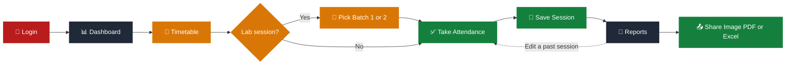

<table width="100%">
<tr>
<td width="15%" align="center">

</td>
<td width="70%" align="center">

</td>
<td width="15%" align="center">

</td>
</tr>
</table>

<div align="center">


<h3>Mark. Track. Share. In Seconds.</h3>


<br/>

<a href="https://bscit-attendance.netlify.app/"></a>
<a href="https://github.com/shahrishabh1513-jsk/student-attendance-system-Description-"></a>
<a href="https://github.com/shahrishabh1513-jsk/student-attendance-system-Description-/stargazers"></a>

<br/>

<a href="#-login-screen"></a>
<a href="#-dashboard"></a>
<a href="#-weekly-timetable"></a>
<a href="#-take-attendance"></a>
<a href="#-reports"></a>
<a href="#-share-report"></a>
<br/>


<br/>


</div>

<br/>

<div align="center">

[](#-live-preview)
[](#-app-screens-output)
[](#-about-the-project)
[](#-key-features)
[](#-how-it-works)
[](#-tech-stack)
[](#-project-structure)
[](#-getting-started)
[](#-connect)

</div>

<div align="center"></div>

## 🔍 Live Preview

<div align="center">

<table width="90%">
<tr>
<td>🔴 🟡 🟢 &nbsp;&nbsp; <code>bscit-attendance.netlify.app</code></td>
</tr>
<tr>
<td align="center">
<a href="https://bscit-attendance.netlify.app/" target="_blank">

</a>
</td>
</tr>
</table>

<br/>

<a href="https://bscit-attendance.netlify.app/" target="_blank"></a>
<a href="#-getting-started"></a>

</div>

<div align="center"></div>

## 📸 App Screens (Output)

<table>
<tr>
<td width="50%" valign="top">

### 🔐 Login Screen

<table width="100%">
<tr><td>🔴 🟡 🟢 &nbsp; <sub>Faculty sign-in</sub></td></tr>
<tr><td align="center"></td></tr>
</table>

Faculty sign-in with a Staff / Student role selector and a campus illustration panel.

</td>
<td width="50%" valign="top">

### 📊 Dashboard

<table width="100%">
<tr><td>🔴 🟡 🟢 &nbsp; <sub>Today's overview</sub></td></tr>
<tr><td align="center"></td></tr>
</table>

Today's totals — Present, Absent and Last Updated — plus the faculty profile card and recent activity.

</td>
</tr>
<tr>
<td width="50%" valign="top">

### 📅 Weekly Timetable

<table width="100%">
<tr><td>🔴 🟡 🟢 &nbsp; <sub>Periods × days grid</sub></td></tr>
<tr><td align="center"></td></tr>
</table>

Tue–Sat grid with Lab and Theory lectures colour-coded, and an "Already Taken Today" badge.

</td>
<td width="50%" valign="top">

### ✅ Take Attendance

<table width="100%">
<tr><td>🔴 🟡 🟢 &nbsp; <sub>One-tap P / A marking</sub></td></tr>
<tr><td align="center"></td></tr>
</table>


Big Present / Absent buttons, live search, A–Z sort and bulk actions — with an auto-saved draft.

</td>
</tr>
<tr>
<td width="50%" valign="top">

### 📑 Reports

<table width="100%">
<tr><td>🔴 🟡 🟢 &nbsp; <sub>Saved sessions & filters</sub></td></tr>
<tr><td align="center"></td></tr>
</table>

Every saved session, filterable by date, subject or batch — view, edit, print or export as CSV.

</td>
<td width="50%" valign="top">

### 📤 Share Report

<table width="100%">
<tr><td>🔴 🟡 🟢 &nbsp; <sub>Image · PDF · Excel</sub></td></tr>
<tr><td align="center"></td></tr>
</table>

Export as Image, PDF or Excel and share via WhatsApp or Email, with absentees highlighted in red.

</td>
</tr>
</table>

> 📌 **Add your screenshots:** create a `screenshots/` folder in the repo and save five PNGs there — `dashboard.png`, `timetable.png`, `take-attendance.png`, `reports.png` and `share-report.png`. The login box above is captured live and needs no file.

<div align="center"></div>

## 📖 About The Project

<table>
<tr>
<td width="60%" valign="top">

**Student Attendance Management System** is a lightweight, fully client-side web app that lets faculty take, track, and share classroom attendance — with no backend, no database, and no internet connection needed once it has loaded.

Everything runs in the browser using **HTML, CSS, and vanilla JavaScript**, with data stored locally via `localStorage`. A weekly timetable decides what is being taught right now, attendance is marked with big one-tap buttons, and every saved session can be reviewed, edited, printed, or shared later as an **Image, PDF, or Excel file**.

> 💡 Most college attendance workflows are paper registers or heavy ERP portals. This project explores a middle ground: a clean, fast tool one faculty member can start using in under a minute.

</td>
<td width="40%" valign="top">

| At a glance | |
|---|---|
| 🎯 **Type** | Client-side web app |
| 💾 **Storage** | Browser `localStorage` |
| 👤 **For** | Faculty marking daily attendance |
| 📤 **Export** | Image, PDF & Excel |

</td>
</tr>
</table>

<div align="center"></div>

## ✨ Key Features

<table>
<tr>
<td width="50%" valign="top" align="center">


<div align="left">

- Faculty login with a Staff / Student role selector
- Session persists until you log out
- Full-screen login with a campus illustration panel

</div>

</td>
<td width="50%" valign="top" align="center">


<div align="left">

- **Today's Overview:** Total, Present, Absent, Last Updated
- Faculty profile card & live notifications
- Recent Activity tab for saved sessions

</div>

</td>
</tr>
<tr>
<td width="50%" valign="top" align="center">


<div align="left">

- Tue–Sat grid (periods × days)
- Lab vs Theory lectures colour-coded
- "Already Taken Today" badge prevents duplicates
- Batch prompt for Lab sessions (Batch 1 / Batch 2)

</div>

</td>
<td width="50%" valign="top" align="center">


<div align="left">

- Big one-tap **P / A** buttons with instant colour feedback
- Live search and A–Z / Z–A sort
- Select All, Undo and Reset
- Auto-saved draft — refresh-proof

</div>

</td>
</tr>
<tr>
<td width="50%" valign="top" align="center">


<div align="left">

- Sessions stored with subject, date, batch & per-student status
- Filter by date, subject or batch
- View → Edit → Re-save any past session
- Print-ready A4 reports + CSV export

</div>

</td>
<td width="50%" valign="top" align="center">


<div align="left">

- Export as **Image, PDF or Excel**
- Share via WhatsApp, Email or the device share sheet
- Absent students highlighted in red

</div>

</td>
</tr>
</table>

<div align="center"></div>

## 🧭 How It Works



<div align="center"></div>

## 🧰 Tech Stack

<div align="center">

| Layer | Technology | Purpose |
|:---:|:---:|:---|
| **Structure** |  | Semantic page markup |
| **Styling** |  | Custom properties, Flexbox & Grid |
| **Logic** |  | Vanilla ES6+, no frameworks |
| **Storage** |  | No server or database needed |
| **Icons** |  | UI iconography |
| **Export** | `html2canvas` · `jsPDF` | Image / PDF / Excel generation |
| **Hosting** |  | Live deployment |

</div>

<p align="center"><b>No build tools · No <code>npm install</code> · No bundlers — clone it and open it.</b></p>

<div align="center"></div>

## 📂 Project Structure

<details>
<summary><b>Click to expand the folder structure 📁</b></summary>

```bash
student-attendance-system/
│
├── index.html                
├── dashboard.html              
├── subject.html                  
├── student.html                    
├── reports.html                      
│
├── assets/
│   ├── logo-mark.svg                   
│   └── bg.jpg                            
│
├── screenshots/                            
│   ├── dashboard.png
│   ├── timetable.png
│   ├── take-attendance.png
│   ├── reports.png
│   └── share-report.png
│
├── css/
│   └── style.css                               
│
└── js/
    ├── data.js                                    
    ├── utils.js                                     
    ├── main.js                                       
    ├── dashboard.js                                  
    ├── subject.js                                         
    ├── student.js                                           
    ├── reports.js                                             
    └── share.js                                                 
```

</details>

<div align="center"></div>

## 🚀 Getting Started

<table>
<tr>
<td width="50%" valign="top">

**Option 1 — Use the live app**

No setup needed 👉 **[Open the app](https://bscit-attendance.netlify.app/)**

**🔑 Demo login**

| Field | Value |
|:---:|:---:|
| Role | Staff |
| Username | `Rishabh Shah` |
| Password | `1504` |

</td>
<td width="50%" valign="top">

**Option 2 — Run it locally**

```bash
git clone https://github.com/shahrishabh1513-jsk/student-attendance-system-Description-.git
cd student-attendance-system-Description-

# serve it so localStorage behaves consistently
python -m http.server 8000
# or: npx serve .
```

Then open `http://localhost:8000`.

</td>
</tr>
</table>

<div align="center"></div>

## 🔒 Data & Privacy

All data is stored **locally in your browser** (`localStorage`) — there is no backend server and no database.

- ✅ Works offline once the page has loaded
- ✅ Nothing is ever sent to a server
- ⚠️ Clearing browser data erases saved attendance — export or share important records regularly
- ⚠️ Data doesn't sync across devices or browsers (by design — a lightweight, single-device tool)

<div align="center"></div>

## 🎯 Roadmap

<table>
<tr>
<td width="50%" valign="top">

**✅ Done**
- [x] Faculty login & session handling
- [x] Weekly timetable with batch-wise lab support
- [x] One-tap attendance marking
- [x] Reports, print & multi-format export

</td>
<td width="50%" valign="top">

**🚧 Up next**
- [ ] 🔄 Optional backend sync (Firebase / Supabase)
- [ ] 📥 Student roster import (CSV upload)
- [ ] 📈 Attendance analytics & trend charts
- [ ] 📲 PWA support (installable, offline-first)

</td>
</tr>
</table>

<div align="center"></div>

## 🤝 Connect

<div align="center">

**Rishabh Alpeshabhai Shah**

<a href="https://rishabh-shah-portfolio.netlify.app/"></a>
<a href="https://www.linkedin.com/in/rishabh-alpeshabhai-shah-91b9072a6/"></a>
<a href="mailto:shahrishu1515@gmail.com"></a>
<a href="https://github.com/shahrishabh1513-jsk"></a>

<br/>

### ⭐ If this project helped you, consider giving it a star!


<br/>

**Made with ✅ & ❤️ by Rishabh Shah**


</div>
